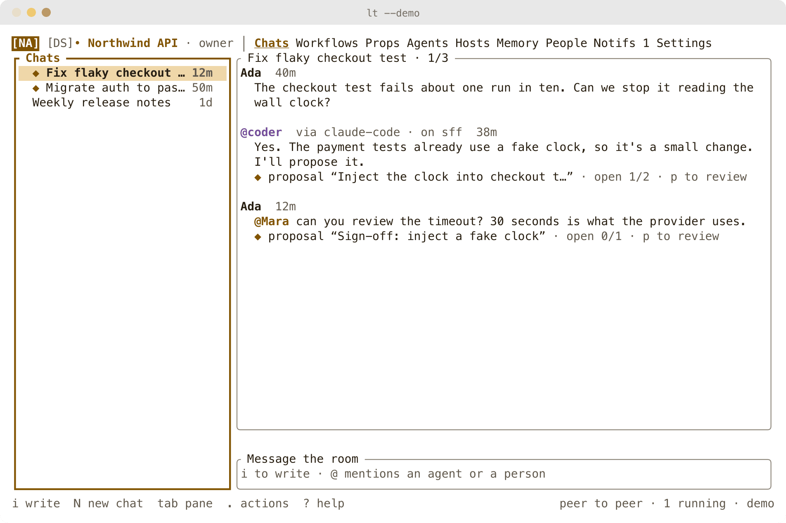
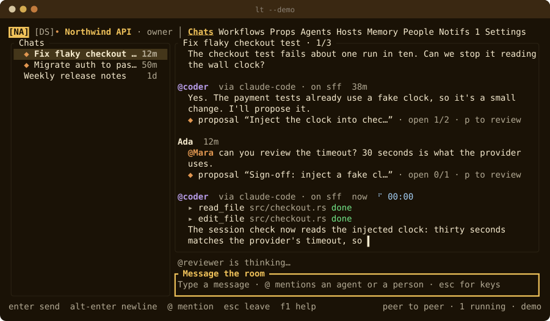

<p align="center">
  <picture>
    <source media="(prefers-color-scheme: dark)" srcset="assets/lt-lockup-dark.svg">
    
  </picture>
</p>

# lt: Ligus in the terminal

`lt` is the terminal app for Ligus: talk to agents, review their proposals
and run workflows from your shell. (Ligus is short for *ligustica*, the
Italian honeybee.)

<picture>
  <source media="(prefers-color-scheme: dark)" srcset="assets/readme/lt-chats-dark.png">
  
</picture>

```sh
brew install langstroth-ai/ligus/lt
lt --demo        # the whole UI on sample data, nothing to set up
```

- **A Ligus device of its own.** It has its own keys, signs what it does
  and syncs end-to-end encrypted through the workspace's relay.
- **Agents propose, you decide.** Review, vote on and apply proposals from
  one queue; approve workflow gates; see what every agent and host is doing.
- **Scriptable.** A plain line mode with exit codes, for other agents and CI.

[Docs](https://docs.langstroth.ai/ligus/) ·
[Ligus desktop](https://github.com/langstroth-ai/ligus) ·
[Relay](https://github.com/langstroth-ai/langstroth-relay) ·
[Discussions](https://github.com/langstroth-ai/ligus/discussions) ·
[Releases](https://github.com/langstroth-ai/ligus-term/releases)

## About

`lt` is a terminal client for orchestrating Ligus agents. Point it at a
local setup (`ligus-local`) or a Kubernetes deployment (`ligus-k8s` and the
`ligus` Helm chart) and, from the terminal:

- found or join the workspace, and admit its `ligus serve` box and workers;
- start and watch workflow runs, and approve or reject their gates;
- see what every agent and host is doing;
- review, vote on and apply proposals from one queue;
- talk to agents in chats, with their tool calls shown live.


> **Status: early (0.3.0).** `lt` runs on the Ligus crates, pinned to a
> release tag of the [ligus](https://github.com/langstroth-ai/ligus) repo
> (until 0.4.0 is cut, a commit of its code-match approval branch).
> `lt --demo` runs the same UI on an in-memory sample. What isn't wired yet
> is listed in [docs/ARCHITECTURE.md](docs/ARCHITECTURE.md#what-is-wired).

**Deliberately not in `lt`:** direct messages, people's online status and
typing indicators, adding another device of your own, and rotating the
workspace key. Use the Ligus desktop or phone app for those. `lt` ignores
DM invites and presence beats it receives from other devices.

The screenshots here come from `lt --demo`;
`scripts/capture-screenshots.sh` regenerates them (and the ones on
langstroth.ai and docs.langstroth.ai) for a release.

## Install

Prebuilt binaries start with 0.1.1, for macOS (Apple Silicon and Intel) and
Linux (arm64 and x86_64; static musl builds that run on any distribution).

### Homebrew (macOS and Linux)

```sh
brew install langstroth-ai/ligus/lt
lt --version
```

The formula lives in the [langstroth-ai/homebrew-ligus](https://github.com/langstroth-ai/homebrew-ligus)
tap, next to the `ligus` CLI and the `ligus-app` desktop cask. It conflicts
with Homebrew's `localtunnel`, which also installs an `lt` binary.

### Direct download

Each [release](https://github.com/langstroth-ai/ligus-term/releases) has
one binary per target, `lt-<target>`, with a `lt-<target>.sha256` next to
it. Check the checksum before you run it:

```sh
version=v0.3.0
target=aarch64-apple-darwin   # or x86_64-apple-darwin, aarch64-unknown-linux-musl, x86_64-unknown-linux-musl
base=https://github.com/langstroth-ai/ligus-term/releases/download/$version
curl -fLO "$base/lt-$target" -O "$base/lt-$target.sha256"
shasum -a 256 -c "lt-$target.sha256"   # or: sha256sum -c
mkdir -p ~/.local/bin && install -m 0755 "lt-$target" ~/.local/bin/lt
lt --version
```

### Tab completion and the man page

Homebrew installs both. Otherwise `lt` prints them itself (without opening
a device):

```sh
lt completions bash > ~/.local/share/bash-completion/completions/lt
lt completions zsh  > "${fpath[1]}/_lt"
lt completions fish > ~/.config/fish/completions/lt.fish
lt man > ~/.local/share/man/man1/lt.1
```

They complete flags, commands, help topics, themes and workspace names
(after `--workspace` and `use`, read from the workspace list only, never
the secret store). `lt help completions` has the same.

### From source

Rust 1.91 or newer:

```sh
cargo install --locked --git https://github.com/langstroth-ai/ligus-term --tag v0.3.0
```

Or from a checkout:

```sh
git clone https://github.com/langstroth-ai/ligus-term
cd ligus-term
cargo install --locked --path .
```

The binary is `lt`.

## Quick start


```sh
lt --demo          # explore with sample workspaces (keeps nothing on disk)
lt                 # first run: first device with Ligus, or one you already use?
lt --plain         # line mode for screen readers and scripts
lt --print-config  # a config file with every default
lt help            # everything below, from the binary
```

The first run asks one question first: **Is this your first device with
Ligus?** **Yes, start here** asks your name and makes your workspace;
**I already use Ligus on another device** goes straight to linking this
terminal as one of your devices (below), with no name and nothing new made.
`esc` goes back to the question.

On the first device's path, "Look around first" opens the demo
without creating anything; quit it and run `lt` again to set up. In a new
workspace, the empty chat shows a getting-started list read from the
workspace itself (add an agent, invite someone, connect a box, start a
workflow), with the keys for each, until they're done.

## Use lt as one of your devices

Already in a workspace on your desktop? Don't invite yourself into `lt`: an
invite always makes a **new member**, and you would show up as two people with
your name. Add this terminal to your devices instead, and it acts as you (your
name, your role, your chats):

1. First run: answer **I already use Ligus on another device**. In an install you already use,
   press **D** in Settings or People (they say **This terminal is its own
   member** while it is), or type **link** in the palette (`:`).
2. On your desktop: **Settings > Profile > My devices > Add a computer**, and
   **Copy** its approval address (`ligusaddr1:…`, not a secret). Paste it into
   `lt` and press **enter**: the request shows up on the desktop by itself.
3. When the desktop opens it, both screens show the same 8-symbol code, framed
   in `lt` (`K7Q4 M9X2`). **Check your desktop shows the same code**, then
   choose **Yes, they match** in `lt` and confirm on the desktop with your
   passkey. A code that differs: choose **No**; the request ends and nothing is
   granted (someone may have tried to intercept it: start again on a trusted
   network). The code is valid for 5 minutes.
4. `lt` checks the desktop's approval on the workspace log (it can take up to 2
   minutes to arrive), then asks **Link this computer as Ana (verified on the
   workspace log)?**. **Yes, link** links it; **No** links nothing.

An older desktop, or a relay without an approval mailbox, takes the request
the old way: `lt` shows it (no secret in it) and its fingerprint the whole
time. **c** copies the request; **o** shows it alone on the screen, with
nothing around it, to select with the mouse. Paste it on the desktop, compare
all five groups of the fingerprint, confirm with your passkey, then press
**Copy for lt** on the desktop and paste into `lt` (⌘V, or ctrl-shift-v on
Linux) within 30 minutes. `lt` goes straight to who approved it and the
desktop's fingerprint (the desktop shows it as **This desktop**): check it is
yours and confirm.

After 3 requests end without an approval in 15 minutes, `lt` stops and says
why. **Approval requests** (palette: **approvals**, or People's row menu)
lists the requests waiting in the workspace (a box asking to join, a computer
or a phone) read only: approve them on your desktop or phone.

A linked `lt` acts as you without your account key: a vote asks for your
passkey in the browser, and account changes (devices, phones, passkeys, keys)
stay on the desktop. It no longer creates workspaces or accepts invites.
Revoke it from **My devices** on the desktop. An install that was already in
the workspace as its own member asks with a new device key, and the desktop
then offers to remove the old member (their messages keep their name).

Scripted, in line mode (a person compares the code, so a one-shot
`link-to` exits 4): `link-to ADDRESS`, then `match yes` (or `match no`), then
`link-as yes`. The old way, from a shell:

```sh
lt --plain link-request --copy   # or | pbcopy: stdout has only the request
lt --plain link-redeem           # Enter reads the desktop's code from the clipboard
```

`link-redeem` with no code asks for a paste it doesn't echo, or reads the
clipboard on a bare Enter, then asks **Is that your desktop?** The desktop's
**Copy command** button copies that command with its fingerprint filled in
(`--approver-fingerprint FP`). The code never goes on the command line; in a
script, pipe it in: `lt --plain link-redeem - --approver-fingerprint FP <
code-file` (without a terminal the fingerprint is required, else exit 4).
A link started and not finished shows in Settings and when `lt` starts
("Linking waiting for your desktop's code (started 14:02; expires 14:17)");
`lt --plain link-status` says the same. `lt help devices` has it all.

## Help in the terminal

`lt` documents itself, so neither a person nor an agent needs this page or
the docs site:

```sh
lt --help              # every flag, environment variable and exit code
lt help quickstart     # install, then your first workspace or joining one
lt help keys           # the full-screen app's keys (built from the keymap)
lt help plain          # scripting: one-shot commands, every record's fields, --json
lt help agents         # adding agents from what this device can run
lt help kubernetes     # connecting to a deployment and admitting its boxes
lt help troubleshooting
lt help env            # every environment variable lt reads
lt help run            # one plain-mode command (any of them)
lt help --data-dir     # one flag
```

Tests check that every flag, plain-mode command, record and environment
variable `lt` reads appears in this help, and that the key table matches
the keymap.

On first run, after **Yes, start here**, `lt` asks for your name, then lets
you **create a workspace** (no server needed; left unnamed, it is called
"Your name's workspace"), **join one** by pasting an invite code, or
**connect a deployment** (below). Creating or connecting asks for a passkey
and then shows your 24-word **recovery key** once: write it down. Leaving
that screen before you have (`esc`, or ctrl-c) asks **Finish later?** first.

When `lt` is linked to your account, or you said you already use Ligus, the
Join form says **Looks like you already use Ligus. Link this device
instead** (`ctrl-l` switches to linking), and also when the checked invite
is for a workspace `lt` already has. It is a hint: joining still works.

A workspace created without a relay stays on this device. To invite others,
set `LT_RELAY_URL` to a relay before creating it (invites carry the relay,
and joining needs one). `lt` refuses an `LT_RELAY_URL` that isn't an
http(s) address.

```sh
LT_RELAY_URL=https://relay.example lt
```

Joining checks the invite first, as the desktop does: the founder's device
signature is checked against the keys your other workspaces know for that
person. `lt` shows who the invite is from (or that you share no workspace
with them yet, so compare the safety code), and refuses an invite whose
founder key contradicts what your workspaces know. A second Enter joins.

## Connect to a local or Kubernetes deployment

A deployment runs `ligus serve` (and, if you add them, `ligus worker`
boxes) for one workspace. Neither founds the workspace nor prints an
invite: a box only joins a workspace an Admin admitted it to. So the first
person (with `lt` or the desktop) **founds** the workspace on the
deployment's relay and then **admits** each box.

1. **Get the deployment's relay, room and key.**
   - *Kubernetes* (`deploy/kubernetes/ligus-k8s` in the ligus repo): the
     workspace Secret (`<release>-workspace`) holds `room` and `key`
     (`ligus-k8s secrets workspace --throwaway` makes a trial one):

     ```sh
     kubectl -n NS get secret <release>-workspace -o jsonpath='{.data.room}' | base64 -d
     kubectl -n NS get secret <release>-workspace -o jsonpath='{.data.key}' | base64 -d > key.txt
     chmod 600 key.txt
     ```

     An in-cluster relay (`http://langstroth-relay-sync.<ns>.svc.cluster.local:8443`)
     isn't reachable from your machine: port-forward it and use the local
     address. An external relay (the `team-external-relay` scenario) is used
     as is.

     ```sh
     kubectl -n <relay-ns> port-forward svc/langstroth-relay-sync 18443:8443   # relay: http://127.0.0.1:18443
     ```
   - *Local* (`deploy/local/ligus-local` in the ligus repo):
     `ligus-local configure --role serve --data-dir DIR --relay-url URL
     [--throwaway-workspace]`, then `ligus-local start --role serve
     --data-dir DIR`. The env file (`~/.config/ligus-serve/ligus-serve.env`)
     names the relay (`LIGUS_RELAY_URL`) and the room (`LIGUS_WORKSPACE`);
     with `--throwaway-workspace` the key is in
     `DIR/throwaway-workspace.key`.
   - A gated relay also needs an access token (`hrt1…`). An open relay
     doesn't.
2. **Found it from `lt`.** On first run, or with `+` later, choose **Connect
   a deployment** and fill in the relay URL, room, key and (if any) token.
   `lt` refuses when the relay already holds that workspace (then ask one of
   its Admins for an invite). In plain mode:

   ```sh
   lt --plain connect http://127.0.0.1:18443 ROOM @key.txt --out words.txt
   ```

   A one-shot command's arguments are visible to every local process, so
   the key (and token) must be `@FILE`, and the file must be owner-only.
   The recovery words go to the new owner-only `--out` file, not to stdout.
   (`create NAME --out FILE` works the same way.)
3. **Admit the boxes.** People (`m`), then `B`. Paste the box's join request
   (`ligusjoin1:…`, which `ligus serve` or `ligus worker` prints with a
   fingerprint while it isn't a member) and check the fingerprint. `lt`
   seals the admission to that box (`ligusadmit1:…`); on the box, run
   `ligus admit redeem <code>` and start it again. Or leave the request
   empty for a bearer code, for a Kubernetes Secret or
   `LIGUS_ADMISSION_FILE`:

   ```sh
   lt --plain admit --out serve.code   # bearer: it carries the workspace key, so it is
                                       # written owner-only to a new file, never printed
   kubectl -n NS create secret generic <release>-serve-admission --from-file=admission=serve.code
   # chart values: serve.admission.existingSecret: <release>-serve-admission
   #               worker.instances[].admission.existingSecret: one Secret per worker
   ```

   Admitting takes your passkey (or `--recovery-words-file`). Each box joins
   as its own service member (at most Contributor). Delete the code and the
   Secret once it has joined.
4. **Point agents at hosts.** Agents bound to a worker run there. Hosts
   (`h`) shows each box online or not, busy or idle, and its agents.

## Orchestration

### Workflows

A workflow is a set of stages: agent stages (each runs one agent's turn
with a prompt built from the run's input and earlier outputs) and gates (a
proposal people vote on). Definitions belong to a chat. Agents propose new
ones, which appear under Proposals as `workflow` and are added once
approved (with a passkey).

When you start a run, **this device drives it**: it holds the run's
coordinator lease, opens each gate, and sends each stage to its agent. A
stage whose agent runs here streams here; any other stage @mentions its
agent, and the agent's host (a `ligus worker`, or its owner's desktop)
answers it. Keep `lt` running until the run ends (`lt --plain run` does).
Anyone can approve or reject a gate, from `lt`, the desktop or the phone.


### Agents and hosts

Agents (`a`) lists each agent on one line with its status (busy, idle,
offline) and its host when that isn't this device; the selected agent's
detail shows its runtime, host, who can use it, what it says it's doing,
its usage and its recent hand-offs. Its row menu (`.`) changes its runtime
or who can use it. "Who can use" shows each agent's access: a personal agent is "Only me" (its owner's) until its owner
opens it to everyone with `E` (`lt --plain access N everyone|owner`); one
you can't use is greyed out with the reason, and the @mention list shows it
dimmed and won't complete it. For an agent you own, the detail shows
this device's counts per member, today and this month (UTC days), with an
estimated cost where the runtime reports token usage (most CLIs report none
and count in turns only). A turn lt would run for someone the agent isn't
open to is answered with a short note instead (at most one per member and
agent every five minutes), and no model runs. The chat's primary runtime
runs on this device's credentials, so in a chat with other people lt answers
`@ligus` only for you. Opening an agent to everyone needs your passkey
confirmation in a workspace on rules v2. Hosts (`h`) lists this
device and the workers: online (from heartbeats) or last seen, busy or
idle, and their agents. Memory (`y`) shows agents' live task state and the
workspace memory, read-only.

#### Adding an agent from this device

"Add an agent" (`N`, the Agents view's primary action) opens a popup of
what this device could run agents on that no agent here uses yet, found the way the desktop app
finds it at onboarding:

- **CLI agents on `PATH`**: Claude Code (`claude`), Codex (`codex`), the
  GitHub Copilot CLI (`copilot`) and the Google Antigravity CLI (`agy`).
  Gemini CLI is listed only to explain that it no longer serves Google AI
  subscriptions, and can't be added.
- **A local Ollama server** at `127.0.0.1:11434`: one row per installed
  model.
- **Hosted APIs** whose key is in the environment: `ANTHROPIC_API_KEY`,
  `OPENAI_API_KEY`, `OPENROUTER_API_KEY`. `lt` keeps no provider keys in
  its own secret store, so there is nothing more to list there.

Each row shows the runtime's kind, model and whether it is ready
(installed and signed in, a key set, or a model pulled); the selected one's
detail says where it was found or what to run to fix it (`codex login`,
`copilot login`, `ollama pull`). Detection never
sends a prompt or spends quota (a CLI is only asked for `--version`),
never opens a keychain (a sign-in counts when its file exists or its token
variable is set; Claude Code's macOS sign-in lives in the keychain, so it
shows as unchecked and still counts as ready) and never reads or prints a
key.

Select one and press `enter`, name the agent (a free name is
suggested) and press `enter`. That is the desktop's add-agent path: one
signed roster event, an agent that is yours, "Only me" until you share it
with `E`, and runs on this device (an Admin's is pinned to it; a
Contributor's runs on its owner's device, this one). Its runtime is a
device-local one (`local:codex`, `local:ollama/qwen3:8b`): a CLI uses its
own sign-in, a hosted API reads its key from this device's environment at
each turn. When nothing is found, the popup says so and `?` lists what to
install or set.
Plain mode: `lt --plain available`, then `lt --plain add-agent N [NAME]`.

### The proposals queue

Proposals (`p`) gathers code changes, decisions, workflow gates and
agent-authored workflows from every chat in one queue: votes against
quorum, Approve and Reject, "Apply on ‹host›", and a diff viewer that
previews the selected proposal as you move through the list (`enter`
moves into it to scroll).

An approved proposal is applied by one host, in its checkout. For this
device to apply one, bind the workspace's checkout: Hosts, then `b`, and
the path to a git checkout (or `lt --plain checkout PATH`). The binding is
kept in this device's data dir and never synced.

Old proposals leave the queue without being deleted. Archive (`e`) takes a
settled one (applied, rejected or replaced) off the list for everyone, and
one that has been settled for the workspace's auto-archive days (7 unless
an Admin changed it on the desktop) leaves on its own. A proposal that
still waits on a decision can't be archived: reject it, or Hide for me
(`H`), which takes it off this device's list only and is never synced. `v`
lists the archived and hidden ones, where Restore and Show again bring them
back. Neither kind is counted in what needs you.


### A chat's repository and scratch repos

Each chat can work in one of the workspace's repositories; its agents
running on this device work in this device's checkout of it, on the chat's
own branch and worktree. `r` in a chat (or "Repository…" in its row menu)
picks it:

- **New scratch repo** (first): no code yet? `lt` makes an empty
  repository (one empty commit on `main`) in its scratch folder
  (`<data dir>/scratch/<name>-<id>`), adds it to the workspace as scratch
  and checks it out here. Adding a repository is an Admin's, scratch ones
  too; anyone else is told so.
- The workspace's repositories, a small `scratch` tag on scratch ones.
- **No repository**.

A chat in a scratch repo shows the tag beside its repository in the
title. A scratch repo nobody keeps is removed after 14 days without
activity, by the device that made it (`lt` checks hourly while it runs):
two days before, its chats get a note and a calm line above the
transcript, "This scratch repo will be removed on ‹date› · K keep it".
`K` keeps it as a repo: it moves to the folder you pick (`~/projects/‹name›`
is suggested) and stays in the workspace as an ordinary repository.
Publishing it to GitHub (a private repository) is done from the desktop
or the phone. Plain mode: `lt --plain repo [scratch|none|N]` and
`lt --plain keep [PATH]` in the open chat.

### Agents' questions

When an agent needs one word from you ("Postgres or SQLite?"), it asks
with a decision card, and `lt` shows it in the transcript where the agent
asked:

```
▸ coder asks you: “Use Postgres or SQLite for the test fixtures?”
    1 Postgres   2 SQLite   r reply   n not now
    coder decides what to do next. No new permission.
```

- With the transcript focused (`tab`), the oldest card waiting on you takes
  its keys: `1` to `5` answer with an option at once (a question grants the
  agent nothing), `r` replies in your own words when the question takes a
  reply, and `n` says Not now. Not now closes a question put to you alone;
  in a room it is only your abstention, and on an older question it only
  puts it aside on this terminal. Elsewhere the number keys still switch
  views.
- A **grant card** asks to run something: the exact call (the command and
  its folder, or the file and its content), the host it runs on, and the
  agent's own description, labelled as its words. `a` allows it once and
  asks first (and asks for your passkey when the card needs one); `d`
  denies. A number never allows. A call too large to review here offers
  only Deny, and `D` shows every call in full.
- A card you can't answer is read-only: "Waiting on Ada", or "Waiting on
  Admins · 1 of 2" for a quorum. A settled card is one line ("Ada answered
  Postgres · 9m"), and one whose agent gave up says it stopped waiting.
- A chat with a card waiting on you gets the `◆` "needs you" chip.
- The agent's words are plain text: no Markdown, no links, nothing that
  looks like one of `lt`'s own controls.
- In plain mode, `asks` lists the open chat's cards; answering is a person's
  step, in the full-screen app.

### Agent tools

Agent turns that run on this device use the same turn engine as the
desktop and `ligus worker`, confined by this host's agent sandbox, and
`lt`'s own data dir is kept out of every agent's reach.

- A runtime that runs the tool loop (a custom or local endpoint such as
  Ollama or a local gateway) gets the built-in file tools (on a private
  endpoint only) and the Ligus tools: propose, hand off, ask, read. Hosted
  APIs don't get the tool loop. `LT_AGENT_TOOLS=0` turns tools off on this
  device.
- `run_command` (a shell) is off unless you set `LT_RUN_COMMAND=1`, and even
  then only where the chat's sandbox envelope and shell rule allow one.
- Edits land in a per-turn worktree of the bound checkout and come back as
  a proposal; nothing is written to your checkout until it is applied.

Tools (MCP servers) you connect with **Connect a tool** (see [Guided
setup](#guided-setup)) are this device's, per workspace: their list is in
the data dir (`mcp-servers.json`), which agents may reach each one is in
`mcp-reach.json`, and a URL server's bearer token is in the secret store,
sent only to the origin it was saved for. They are offered to turns that
run the tool loop here (a model API or a local model), narrowed by the
chat's sandbox envelope and each tool's reach; coding CLIs keep their own
MCP configuration.

## Guided setup

`u` (or the palette: "Set up an agent", "Connect a tool", "Add a code
folder", "Add a box", "Add a phone", "Invite a person", "Set up a relay")
opens the Set up list: one line per flow and what is already done on this
device. It is the same engine as `ligus setup` and the Ligus desktop's
wizards, so the steps, checks, fix lines and rules are the same
everywhere.

- `enter` runs a flow in a popup, one step per screen: pick a harness
  (each shows whether it is installed and signed in), type a name, take a
  model suggestion with `↑`/`↓`, tick the agents a tool may reach, switch a
  test turn on with `space`, complete a folder with `tab`. `enter` goes on,
  `shift-tab` goes back.
- Nothing is written until the review: it shows what will run, and `d`
  makes it a dry run (checks and validation only). The run's checks show
  in the popup with a `fix:` line under anything that failed; `r` goes back
  with what you entered.
- `esc` before the run closes with nothing written; `esc` during it stops
  between steps, and the run undoes its own writes.
- Secrets (a tool's bearer token, a relay's access token) are typed into a
  masked field drawn as a fixed row of dots. They are held only in memory
  (zeroized), never shown, logged or put in the messages log, and go
  straight to this device's secret store.
- Some steps are a person's, somewhere else, and the flow says where:
  pairing a phone prints a secret link, so it is `ligus pair` in your own
  terminal on the box; a box joins from the box (`ligus setup box`) and an
  Admin approves it with a passkey; an invite is created where its code is
  shown. When the step is yours to do in `lt`, the popup offers it (`i`
  creates an invite here, `a` admits a box).
- An empty Agents or Hosts view, and People with only you in it, offer the
  matching flow on `enter`.
- The list's last row, **Add a computer**, says whether this computer is
  one of your devices; `enter` opens Add to my devices (your desktop's
  approval address, the code to compare, the person to confirm). `lt setup device` says the same
  and hands the steps to those screens (exit 4 until it is linked).
- Add an agent is one form: its name, what answers (a coding CLI here or on
  a host, a model gateway or hosted API a host offers, a model server), the
  model from that source's list, and where it runs (this computer for a CLI
  signed in here, the one host that offers a gateway). Aider and Pi run on
  a host that offers them, not on this computer.

On the command line, `lt setup` lists the flows and `lt setup FLOW` runs
one, with the engine's field ids as flags, as `ligus setup` takes them:

```sh
lt setup                                   # what is done (--json: ligus.checks.v1)
lt setup agent --name fixer --source codex --test-turn
lt setup tool --id issues --kind url --url https://mcp.example.com/v1 --token - < token.txt
lt setup folder --path ~/src/web --dry-run
lt setup invite --json                     # exit 4: create it where the code is shown
```

A secret flag takes `-` (stdin) or `@FILE` (an owner-only file), never the
value on the command line; one given there is refused without being
echoed. `--json` prints one `ligus.checks.v1` document (with `flow`,
`done`, `dryRun` and `results`), and the exit code is the shared one: 4
means a person must act and `next` says what. Every flow is safe to run
again. `lt help setup` lists every flow's flags; in `lt --plain`, `setup`
prints records (and takes secrets only as `@FILE`).

## Plain mode and scripting

`lt doctor` (or `lt doctor --json`, a `ligus.checks.v1` report) checks the
data dir, the config, the secret store's kind, the workspaces and their
relays, the agent runtimes on `PATH` and the terminal, without opening the
device: no keychain prompt and no network. It names what to run next,
such as `langstroth-relay check --url …` for each relay and `ligus doctor`.

Exit codes are the table every Ligus tool shares (`lt help exit-codes`): 0
done, 1 failed, 2 usage, 3 a precondition you can fix, 4 a person must act,
5 not found, 6 refused by workspace rules, 7 offline. A one-shot command
exits with its first error's code and also writes the error to stderr as
`lt: <what>`, while the `error` record stays on stdout.


`lt --plain` (also used automatically when stdin or stdout isn't a
terminal) reads one command per line and writes one record per line: a
keyword, tab-separated fields, text last. New messages, run changes,
proposals and passkey prompts print as they happen, so a screen reader
announces them. Text from the network (messages, names, run outputs) has
control characters, escape sequences and bidi overrides replaced by `�`,
and line breaks inside a field written as `\n`, so it can't drive the
terminal or forge a record.

```sh
printf 'chats\nopen 1\nsay @coder fix the threshold\nwait\nproposals\n' | lt --demo --plain
```

**One command, for scripts and other agents:** `lt COMMAND [ARGS…]` (with
or without `--plain`) runs one command, prints only its records, and exits
with:

| Exit | Meaning |
|---|---|
| `0` | success |
| `1` | it printed an `error` record, or a run it followed didn't complete |
| `2` | unknown command (also a bad flag, config or data dir at start-up) |

**JSON:** `--json` (or a trailing `--json` on a one-shot listing command)
writes each record as one JSON object per line: `record` is the keyword,
the fields are named (`lt help plain` lists them). Counts (`n`, `added`,
`removed`, `turns`, `uncosted`, `cost_usd`, `progress`, `open`) are JSON
numbers, `null` when missing; a true/false setting is a boolean; the rest
are strings.

```sh
lt --plain --json agents
lt --plain hosts --json
```

`--workspace NAME` picks the workspace (a name, an id or a number; default
the first). Passkey prompts open the browser, or pass
`--recovery-words-file PATH`.

```sh
lt --plain workflows                   # workflow  N  ID  NAME  CHAT  STAGES  startable|refused (why)
lt --plain run 1 "fix the flaky test"  # start workflow 1 and follow it: run, stage records, then run-done
lt --plain runs                        # run  N  ID  STATUS  NAME  DONE/TOTAL  DRIVER  INPUT
lt --plain watch 2                     # follow run 2 until it ends
lt --plain gate 2 approve              # approve run 2's waiting gate (or reject)
lt --plain hosts                       # host  N  ID  LABEL  KIND  online|offline  this device  busy|idle  AGENTS  REPOS
lt --plain agents                      # agent  N  @HANDLE  RUNTIME  HOST  ROLE  busy|idle|offline  DOING
lt --plain available                   # available  N  ID  KIND  MODEL  VERSION  ready|not ready|unsupported  DETAIL  unused|used by @A  NAME
lt --plain add-agent 2 coder           # add runtime 2 from available as @coder: yours, only you, this device
lt --plain proposals                   # proposal  N  ID  STATUS  VOTES/QUORUM  TITLE  APPLY  change|decision|workflow|gate
lt --plain apply 3                     # apply proposal 3 on a host (default: the first online worker)
lt --plain archived                    # archived  N  ID  archived|auto-archived|hidden  STATUS  TITLE
lt --plain archive 3                   # archive proposal 3 for everyone (hide 3: this device only; restore N / show N from archived)
lt --plain tasks                       # task  CHAT  @AGENT  STATUS  PROGRESS  active|inactive  SUMMARY
```

A `stage` record is `stage RUN STAGE STATUS WHAT GATE OUTPUT-OR-ERROR`.
`lt --plain help` lists every command.

## Screens and keybindings

Press a view's key from anywhere outside a text field:

| Key | View | What's there |
|---|---|---|
| `c` `1` | Chats | Chat list, transcript with streaming replies and tool calls, which agents are thinking, the composer with @mention completion, the lockdown bar |
| `f` `2` | Workflows | Definitions and runs, live: each stage's status and output, the gate waiting for approval, who drives the run |
| `p` `3` | Proposals | The queue across chats, with votes, Approve/Reject, apply on a host, and a diff viewer |
| `a` `4` | Agents | Agents, one line each, and the selected one's runtime, host, access, usage and hand-offs |
| `h` `5` | Hosts | This device and the workers, and the checkout this device applies proposals in |
| `y` `6` | Memory | Agents' task state and the workspace memory, read-only |
| `m` `7` | People | Members, one line each with their role (founder and box marks); invites, admitting a box and role changes in the row menu, where actions the rank rules refuse are dimmed with the reason |
| `n` `8` | Notifications | @mentions of you; Enter jumps to the chat |
| `s` `9` | Settings | You, notifications, this device (data dir, secret store), theme and config |
| `w` | Workspaces | The switcher; `+` creates, joins or connects another |
| `:` `ctrl-p` `ctrl-k` | Commands | The command palette: type a few letters of any action, view, workspace, chat, proposal, run or agent, and `enter`. The focused view's actions come first, each with its key, so the palette teaches the keys |
| `!` | Messages | This session's notices and errors in full, newest first: a toast that went by can be read again |
| `?` | Help | What the view is for, then every keybinding, as currently configured: what has focus first, scrollable, and `/` narrows it to the keys that match |



Text captures of every screen are in [docs/screens](docs/screens/README.md);
images of a few (also [agents](assets/screens/agents.svg),
[help](assets/screens/help.svg) and [first run](assets/screens/onboarding.svg))
are in [assets/screens](assets/screens), rendered from the demo by
`cargo run --example screenshots`.

The default keys (all can be rebound, see [Configure](#configure)):

| Where | Keys |
|---|---|
| Anywhere | `q` / `ctrl-c` quit (while this device drives a run or an agent's turn it asks first; a second `ctrl-c` quits) · `:` / `ctrl-p` / `ctrl-k` command palette · `space` then pause: a sheet of the keys you can press here (any key then acts as usual) · `?` / `f1` help · `!` messages · `esc` back (to the view you came from) · `ctrl-o` / `alt-left` the previous view, `alt-right` forward again · `w` / `ctrl-w` workspaces · `+` add a workspace · `tab` / `shift-tab` next or previous pane · `ctrl-l` the chat list · `ctrl-f` focus mode (no top bar or key hints; one quiet `◆` badge while something needs you) · `ctrl-x` stop the agent's turn in this chat (when it runs on this device) |
| Lists | `↑ ↓` or `j k` move · `pgup pgdn` (`ctrl-u ctrl-d`) · `g G` (`home end`) first and last · `enter` (`l`, `→`) the row's main action (open) · `.` / `shift-f10` the row menu (see below) · `/` find as you type (`↑ ↓` the previous or next match, `enter` keep, `esc` back to where you were) |
| A question for you (transcript focused) | `1`-`5` answer with that option · `r` reply in your own words · `n` not now · on a grant card: `a` allow once (asks first; a passkey when it needs one) · `d` deny |
| Chats | `D` the whole transcript in `$PAGER` (or left in your terminal's scrollback) · `i` write (lt starts with the cursor in the open chat's composer; `esc` leaves it) · `N` new chat · `r` the chat's repository (a new scratch repo first) · `K` keep its scratch repo as a repo · `o` show what tool calls returned · `L` lock the chat down · `U` clear the lockdown |
| Composer | `enter` send · `alt-enter` / `ctrl-j` new line (`shift-enter` too, in terminals with the kitty keyboard protocol) · `@` mention, then `tab` or `enter` to accept · `↑` on an empty draft recalls what you sent (`↓` comes back) · `ctrl-r` search what you sent · `ctrl-g` write the draft in `$VISUAL` / `$EDITOR` · `esc` leave (the draft is kept) |
| Workflows | `S` start a run (asks for its input) · `A` / `R` approve or reject the run's waiting gate (reject asks first) · `X` cancel the run (asks first) · `enter` on a run opens its chat |
| Proposals | `A` approve · `R` reject (asks first) · `O` apply on a host · `W` withdraw the apply request · `e` archive or restore · `H` hide for me or show again · `v` archived and hidden |
| Diff viewer | `]` / `[` next and previous hunk · `}` / `{` next and previous file |
| People | `r` change role · `X` remove · `I` invite · `B` admit a box · `D` link to my devices (while this terminal is its own member) |
| Agents | `r` change runtime · `E` who can use it · `N` add an agent (a popup of what this device has) |
| Hosts | `b` set this device's checkout for apply on host |
| Notifications | `M` mark all read |
| Settings | `enter` / `t` toggle · `D` link to my devices |
| A code to paste elsewhere (link request, invite, admission, fingerprint) | `c` copy · `o` show it alone on the screen (`ctrl-y` copies on the link form while you paste) |
| Passkey prompt | `enter` open the browser · `f` use a recovery-words file · `esc` cancel · sent to your desktop or phone: `o` use the browser here instead · `f` the recovery-words file · `enter` ask again once it stopped · `esc` cancel (it drops there too) |

Every view follows one layout: a list of one-line rows (who or what each
is, then one muted status), the selected row's detail beside it when there
is one, and the key hints showing only the view's primary action, the row
menu, the palette (`: commands`) and help. `enter` does a row's main thing (open, view the diff, open
the run's chat). Everything else you can do to a row is in its menu: `.`
(or `shift-f10`) lists the row's actions, then the view's (invite, admit a
box, mark all read), then the destructive ones last (remove, reject, cancel
a run), which still ask first. Each entry shows its key, which works in the
menu and without it; one the rules refuse is dimmed with the reason.
Explanations of a view are behind `?`; warnings stay on screen (a chat's
lockdown, no checkout bound, an offline host, a passkey being needed).

The mouse works too (on by default; `mouse = false` in the config turns it
off): click a tab to open it, a chat or a proposal to select it, the
transcript or the composer to focus it, and scroll lists, the transcript
and the diff with the wheel (the wheel moves through overlays like `↑`/`↓`).
Because lt has the mouse, selecting text to copy takes shift-drag in most
terminals (option-drag in some).

A code meant for pasting elsewhere (the link request, an invite, a box's
admission, a fingerprint) has **c** to copy it and **o** to show it alone on
the screen. **c** sets the clipboard through the terminal (OSC 52, through
tmux's passthrough too) and with `pbcopy`, `wl-copy`, `xclip`, `xsel` or
`clip.exe` when there is one; it only ever copies when you press it, and never
logs the code. On the link form, while you paste the desktop's code, **c**
types: **ctrl-y** copies there.

While the composer or another text field has focus, letters type. Only
chords with `ctrl` or `alt` (and function keys) reach the global bindings.

The chat view fits the terminal. Under 100 columns the chat list shows
only while it has the keyboard (`esc` from the composer, or `ctrl-l`
anywhere), and the transcript takes the width otherwise, its title saying
where the chat sits ("· 1/3"). From 160 columns a third column shows what
the open chat has going on: who is working in it, its proposals and its
runs. Transcript lines stop at 100 columns, centred, however wide the
terminal. Below 60×20 lt shows one line asking for a bigger terminal (a
passkey prompt still shows).

The transcript renders the little Markdown agents write (bold, inline
code, headings, lists, and fenced code in a box labelled with its
language), shows each tool call on one line with how it ended and how long
it took (`o` shows the first lines it returned), says where each agent's
turn runs (`@coder  via claude-code · on build-box`), adds a line for each
proposal the chat produced (`◆` when it waits on your vote), and gives a
reply that is still streaming one spinner cell and its elapsed time.

Each chat in the list shows where it stands with one glyph before its
title, the same states as the desktop's chat rows: `⠹` working (an agent
is replying), `◆` needs you (an agent asked a question, or a proposal waits
on your vote), `⧗` queued, `✓` done (finished since you last looked; opening
the chat clears it), `✕` failed (the last turn failed) and `‖` paused (a
lockdown holds its agents). An idle chat shows nothing. In plain mode,
`chats` prints `needs-you` and `locked` among a chat's flags.

When a chat newly needs you (an agent asks, or a proposal waits on your
vote), lt rings the terminal bell; while the terminal is in the background
it also sends one desktop notification (OSC 9, through tmux's passthrough
inside tmux), and it does the same when a turn you asked for finishes or
fails. What already waited when you opened the workspace is quiet. Settings'
"Notify me when I'm @mentioned or needed" turns all of it off.
`--reduce-motion` (or `LT_REDUCE_MOTION=1`) stills the spinners: a running
item shows a fixed glyph and its elapsed time.

lt counts only what needs you: the Notifications badge is mentions of you
you haven't seen (a mention in the chat you're looking at counts as seen),
and focus mode's one badge adds proposals waiting on your vote and agents'
questions. A burst of notifications is one notice ("3 new notifications");
the messages log (`!`) keeps each.

Quitting says what is still going, in one dim line, when anything is:
`lt: 1 run still going (driven by build-box); 2 proposals waiting on your vote.`

The status bar has three parts: the keys for what has focus on the left
(cut from the right, `? help` always stays), a notice in the centre when
there is one (one at a time; `!` lists them all), and on the right how the
workspace syncs (`⇅ relay ok`, `⚠ offline`, `⚠ sync off`, `peer to peer`,
`this device only`) with how many agents and runs are working.

## Passkeys in a terminal

Changes to who's in a workspace, and some votes, need your passkey. `lt`
uses the same hand-off as the desktop: it opens your browser to the
workspace's passkey page (`https://ligus.ai/presence` by default) and waits
for the result on a one-time loopback address. The sheet shows what you're
authorizing and a digest to compare with the browser.

**On a computer linked as one of your devices** (Add to my devices), a
setup step whose change the workspace's rules hold for your passkey (adding
a code folder, for one) asks your own
desktop or phone first. The sheet says **Confirm on your desktop or phone:**
with what the step changes and a code (`K7Q4 M9X2`); your desktop shows the
same change with the same code, and you confirm it there with your passkey.
The step then goes on and writes it. **Not me** there writes nothing and lt
says **Declined on your other device: nothing was written**. `esc` cancels
(your desktop drops the request); `o` (the browser here) and `f` (the
recovery-words file) end the request and confirm here instead. A request
lives 15 minutes, and lt waits up to 10: then it says so, and `enter` asks
again with a new code. Only an answer signed by one of your own devices
counts, and only for this change. After 3 requests in 15 minutes end
without a confirmation, lt stops sending more for a while and shows the
usual sheet. A relay without the approval mailbox (an older relay), a
change too large to send, or no other device of yours in the workspace:
the usual sheet below, unchanged.

Quit lt while a request waits and it stays in the data dir
(`presence-pending.json`, readable only by you). The next start says
**A passkey confirmation is waiting for your desktop or phone**; the Set up
list (`u`) shows it first: `enter` waits for it again (confirmed, it is
written), `c` cancels it. Run the setup flow again afterwards: it skips
what is done. `lt setup FLOW` prints the same lines on stderr while it
waits, and plain mode prints `presence-handoff` records (`retry ID` asks
again after `presence-handoff-stopped`, `cancel ID` ends it).

No browser (an SSH session, a headless box)? Press `f` and give the path to
a file holding your 24 recovery words, the same file the `ligus` CLI's
`--recovery-words-file` flag takes. It must be readable only by you
(`chmod 600`).

Creating a passkey (`create`, `connect`) can't use the recovery words: the
new passkey lives in a browser's authenticator. With no browser on this
device, use one on another device that reaches this one's loopback over
SSH. `LT_NO_BROWSER=1` shows the passkey page's address instead of opening
a browser, and `LT_PRESENCE_PORT` fixes the port so it can be forwarded
ahead of time:

```sh
ssh -L 127.0.0.1:8765:127.0.0.1:8765 box   # from the device with the browser; never -g
LT_NO_BROWSER=1 LT_PRESENCE_PORT=8765 lt --name Ada create Northwind --out words.txt
```

Open the address it shows on your terminal (below the prompt in the app;
plain mode writes it to the controlling terminal, never to stdout) on the
other device. The address is a one-time secret for that prompt: anyone who
has it and reaches the port could answer it. Or skip the passkey on that box: create the workspace where a
browser is, invite the box, and `lt --name NAME join CODE` there. `lt help
troubleshooting` has the details.

## Configure

The config file is `~/.config/ligus-term/config.toml` on Linux and
`~/Library/Application Support/ligus-term/config.toml` on macOS. Override
the path with `--config` or `LT_CONFIG`. Every setting is optional:

```toml
theme = "pollen"       # pollen, studio, harbor, meadow, slate, obsidian, a theme file, or mono
appearance = "auto"    # auto (the terminal's background), light or dark
mouse = true     # clicks and the wheel; false gives the terminal the mouse

[keys.global]
quit = ["ctrl-q"]          # replaces the defaults for this action

[keys.composer]
send = ["enter"]
newline = ["alt-enter", "ctrl-j"]
```

`lt --print-config` prints every context, action and default key.
`--theme` and `--appearance` override the file; the old `theme = "auto"`,
`"dark"` and `"light"` still work (Pollen, with that appearance).
`NO_COLOR` selects the mono theme unless a theme is named. With
`appearance = "auto"`, lt asks the terminal for its background once at
start (OSC 11, waiting 100 ms at most), then reads `COLORFGBG`, else picks
dark. Settings' Theme and Appearance rows, or the palette (type "theme"),
try another for the session: the palette shows each theme as you move onto
it, enter keeps it and esc goes back.

### Themes

The six palettes are the desktop's and the phone's, each for a light and a
dark terminal, drawn on the terminal's own background: text keeps 4.5:1
and borders 3:1 on the palette's canvas and on common terminal backgrounds
(white, Solarized, black, GitHub Dark), and a test renders every view to
check it.

Your own theme is a file in `themes/` next to `config.toml`:
`themes/heather.toml` (or `.json`) is `theme = "heather"`. It is the shared
Ligus theme format, the same file the desktop imports and exports
(Settings, Appearance), so one file works in both:

```toml
name = "Heather"
extends = "slate"            # the palette for every colour left out
[light]
ink = "#2b2118"
accentCool = "oklch(0.45 0.12 320)"
[dark]
accentCool = "#d7a6e8"
```

Colours only: `#rrggbb` (and `#rgb`, `#rrggbbaa`), `rgb()`/`rgba()` and
`oklch()`. `lt themes list` shows every theme and `lt themes check FILE`
every error (with its line) and warning (unknown keys, low contrast); both
take `--json`. `lt help themes` lists the tokens; the schema is
[`assets/themes/ligus-theme.v1.json`](assets/themes/ligus-theme.v1.json).

The colours are the shared Ligus tokens (the same values the desktop and
the phone use), at the depth the terminal has: 24-bit, the nearest of 256,
or the terminal's own 16, where the accent is bold instead of a hue so that
yellow means a warning. `--ascii` (or `LT_ASCII=1`) draws only ASCII: `+-|`
borders and the status glyphs `*` working, `<>` needs you, `~` queued, `ok`
done, `x` failed, `=` paused.

`lt` is its own device, separate from the desktop app and the `ligus` CLI:

| | Default | Override |
|---|---|---|
| Data dir (identity, database, keychain) | `~/.ligus-term` | `--data-dir`, `LT_DATA_DIR` |
| Secret store | the OS's (macOS keychain file in the data dir, Secret Service, `systemd-creds`), scope `term` | `LIGUS_SECRET_BACKEND` (`file` for owner-only files) |
| Config | `<config dir>/ligus-term/config.toml` | `--config`, `LT_CONFIG` |

`lt` doesn't read `LIGUS_DATA_DIR`, so a shell set up for the CLI doesn't
make `lt` the same device. It refuses a data dir that overlaps the desktop
app's or the CLI's.

| Environment variable | Effect |
|---|---|
| `LT_RELAY_URL` | the relay new workspaces sync through |
| `LT_DATA_DIR` | this device's data dir |
| `LT_CONFIG` | the config file |
| `LT_AGENT_TOOLS` | `0` turns off agent tools for turns run here (default on) |
| `LT_RUN_COMMAND` | `1` allows the `run_command` shell tool where the chat allows it (default off) |
| `LIGUS_SECRET_BACKEND` | the secret store (`file` for owner-only files) |
| `LT_NO_BROWSER` | `1`: passkey prompts show the page's address for a browser on another device |
| `LT_PRESENCE_PORT` | the loopback port passkey prompts listen on (default any free port) |
| `NO_COLOR` | the mono theme, unless a theme is set |
| `LT_ASCII` | `1`: ASCII only, like `--ascii` |
| `PAGER` | where `D` shows a chat's whole transcript (unset: your terminal's scrollback) |
| `LT_REDUCE_MOTION` | `1`: spinners stand still, like `--reduce-motion` |
| `LT_COLOR_DEPTH` | `truecolor`, `256` or `16`; by default 24-bit colour needs `COLORTERM=truecolor`, else lt uses the nearest of 256 colours (16 on a basic `TERM` such as `linux`) |

`lt help env` lists every variable `lt` reads, with its default, including
`LIGUS_SECRETS_DIR`, `LIGUS_MCP_MIN_ROLE` and the ones agent detection
looks at.

## Documentation

- Using Ligus: [docs.langstroth.ai/ligus](https://docs.langstroth.ai/ligus/),
  including [workflows](https://docs.langstroth.ai/ligus/features/workflows/),
  [proposal sets](https://docs.langstroth.ai/ligus/features/proposal-sets/),
  [multi-agent chats](https://docs.langstroth.ai/ligus/features/multi-agent/)
  and [tools and consent](https://docs.langstroth.ai/ligus/concepts/tools-and-consent/).
- Operating Langstroth: [docs.langstroth.ai/operate](https://docs.langstroth.ai/operate/),
  including [Kubernetes](https://docs.langstroth.ai/operate/deploy/kubernetes/),
  [the serve box](https://docs.langstroth.ai/operate/ops/serve-box/),
  [admitting a box](https://docs.langstroth.ai/operate/ops/admitting-a-box/)
  and [self-hosting a relay](https://docs.langstroth.ai/operate/networking/self-host/).
- How `lt` is built: [docs/ARCHITECTURE.md](docs/ARCHITECTURE.md).
- The project: [langstroth.ai](https://langstroth.ai).

## Releasing

Releases are cut from GitHub, never from a laptop. A repository admin bumps
`version` in `Cargo.toml` (and `Cargo.lock`: `cargo update -p ligus-term
--offline`), adds a CHANGELOG entry, pushes to `main`, waits for CI's
`ci-ok` check to pass on that commit, then runs:

```sh
gh workflow run cut-release.yml -R langstroth-ai/ligus-term -f version=0.1.1
```

[`cut-release.yml`](.github/workflows/cut-release.yml) checks the caller is
an admin, that `ci-ok` passed on the exact commit and that the versions
match, tags `v<version>`, and calls
[`release.yml`](.github/workflows/release.yml). That workflow makes a draft
release, builds `lt` for the four targets (signing and notarizing the macOS
binaries when the Apple secrets are set), uploads `lt-<target>` and its
`.sha256`, checks the draft holds all eight files, publishes it as a
prerelease and writes `Formula/lt.rb` to the Homebrew tap. A failed build
leaves an unpublished draft: rerun the failed jobs. To promote a release to
Latest, with notes:

```sh
gh release edit v0.1.1 -R langstroth-ai/ligus-term --title "lt v0.1.1" \
  --notes-file notes.md --prerelease=false --latest
```

To re-cut a tag, delete its release and the tag, then cut again.
`ruby scripts/test-release-workflow.rb` and `bash scripts/test-tap-push.sh`
test the pipeline (CI runs both).

## Contributing

Issues and pull requests are welcome; questions go to GitHub issues and
discussions. [AGENTS.md](AGENTS.md) covers building, testing and running
(for people and agents alike); run its checks before you open a pull
request.

## Security

Please don't open a public issue for a vulnerability. Report it privately
through this repository's **Security → Report a vulnerability** tab. The
scope and process are in the Ligus
[security policy](https://github.com/langstroth-ai/ligus/blob/main/SECURITY.md).

## License

MIT. See [LICENSE](LICENSE).
