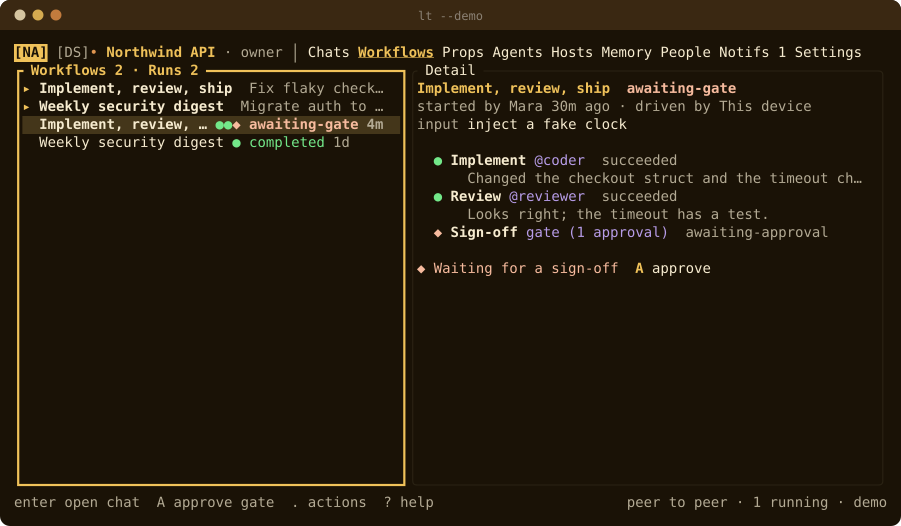
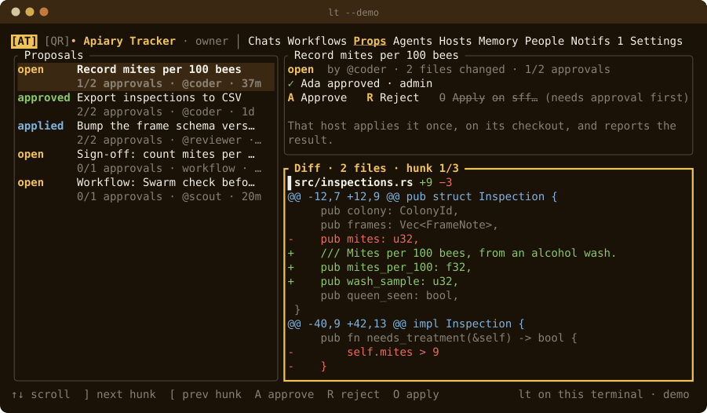

<p align="center">
  <picture>
    <source media="(prefers-color-scheme: dark)" srcset="assets/lt-lockup-dark.svg">
    
  </picture>
</p>

# lt: Ligus in the terminal

`lt` is a terminal client for orchestrating Ligus agents. (Ligus is short
for *ligustica*.) Point it at a local setup (`ligus-local`) or a Kubernetes
deployment (`ligus-k8s` and the `ligus` Helm chart) and, from the terminal:

- found or join the workspace, and admit its `ligus serve` box and workers;
- start and watch workflow runs, and approve or reject their gates;
- see what every agent and host is doing;
- review, vote on and apply proposals from one queue;
- talk to agents in chats, with their tool calls shown live.

A plain line mode makes all of it scriptable for other agents and CI, with
exit codes.


`lt` is a Ligus device in its own right: it has its own keys, signs its
events like the desktop app does, and syncs end-to-end encrypted through
the workspace's relay.

> **Status: early (0.1.1).** `lt` runs on the Ligus crates, pinned to a
> release tag of the [ligus](https://github.com/langstroth-ai/ligus) repo.
> `lt --demo` runs the same UI on an in-memory sample. What isn't wired yet
> is listed in [docs/ARCHITECTURE.md](docs/ARCHITECTURE.md#what-is-wired).

**Deliberately not in `lt`:** direct messages, people's online status and
typing indicators, adding another device of your own, and rotating the
workspace key. Use the Ligus desktop or phone app for those. `lt` ignores
DM invites and presence beats it receives from other devices.

## Install

Prebuilt binaries start with 0.1.1, for macOS (Apple Silicon and Intel) and
Linux (arm64 and x86_64; static musl builds that run on any distribution).

### Homebrew (macOS and Linux)

```sh
brew install langstroth-ai/ligus/lt
lt --version
```

The formula lives in the [langstroth-ai/homebrew-ligus](https://github.com/langstroth-ai/homebrew-ligus)
tap, next to the `ligus` CLI and the `ligus-app` desktop cask. It conflicts
with Homebrew's `localtunnel`, which also installs an `lt` binary.

### Direct download

Each [release](https://github.com/langstroth-ai/ligus-term/releases) has
one binary per target, `lt-<target>`, with a `lt-<target>.sha256` next to
it. Check the checksum before you run it:

```sh
version=v0.1.1
target=aarch64-apple-darwin   # or x86_64-apple-darwin, aarch64-unknown-linux-musl, x86_64-unknown-linux-musl
base=https://github.com/langstroth-ai/ligus-term/releases/download/$version
curl -fLO "$base/lt-$target" -O "$base/lt-$target.sha256"
shasum -a 256 -c "lt-$target.sha256"   # or: sha256sum -c
mkdir -p ~/.local/bin && install -m 0755 "lt-$target" ~/.local/bin/lt
lt --version
```

### From source

Rust 1.91 or newer:

```sh
cargo install --locked --git https://github.com/langstroth-ai/ligus-term --tag v0.1.1
```

Or from a checkout:

```sh
git clone https://github.com/langstroth-ai/ligus-term
cd ligus-term
cargo install --locked --path .
```

The binary is `lt`.

## Quick start

```sh
lt --demo          # explore with sample workspaces (keeps nothing on disk)
lt                 # first run: your name, then create, join or connect a workspace
lt --plain         # line mode for screen readers and scripts
lt --print-config  # a config file with every default
lt help            # everything below, from the binary
```

## Help in the terminal

`lt` documents itself, so neither a person nor an agent needs this page or
the docs site:

```sh
lt --help              # every flag, environment variable and exit code
lt help quickstart     # install, then your first workspace or joining one
lt help keys           # the full-screen app's keys (built from the keymap)
lt help plain          # scripting: one-shot commands, every record's fields, --json
lt help agents         # adding agents from what this device can run
lt help kubernetes     # connecting to a deployment and admitting its boxes
lt help troubleshooting
lt help env            # every environment variable lt reads
lt help run            # one plain-mode command (any of them)
lt help --data-dir     # one flag
```

Tests check that every flag, plain-mode command, record and environment
variable `lt` reads appears in this help, and that the key table matches
the keymap.

On first run `lt` asks for your name, then lets you **create a workspace**
(no server needed), **join one** by pasting an invite code, or **connect a
deployment** (below). Creating or connecting asks for a passkey and then
shows your 24-word **recovery key** once: write it down.

A workspace created without a relay stays on this device. To invite others,
set `LT_RELAY_URL` to a relay before creating it (invites carry the relay,
and joining needs one). `lt` refuses an `LT_RELAY_URL` that isn't an
http(s) address.

```sh
LT_RELAY_URL=https://relay.example lt
```

Joining checks the invite first, as the desktop does: the founder's device
signature is checked against the keys your other workspaces know for that
person. `lt` shows who the invite is from (or that you share no workspace
with them yet, so compare the safety code), and refuses an invite whose
founder key contradicts what your workspaces know. A second Enter joins.

## Connect to a local or Kubernetes deployment

A deployment runs `ligus serve` (and, if you add them, `ligus worker`
boxes) for one workspace. Neither founds the workspace nor prints an
invite: a box only joins a workspace an Admin admitted it to. So the first
person (with `lt` or the desktop) **founds** the workspace on the
deployment's relay and then **admits** each box.

1. **Get the deployment's relay, room and key.**
   - *Kubernetes* (`deploy/kubernetes/ligus-k8s` in the ligus repo): the
     workspace Secret (`<release>-workspace`) holds `room` and `key`
     (`ligus-k8s secrets workspace --throwaway` makes a trial one):

     ```sh
     kubectl -n NS get secret <release>-workspace -o jsonpath='{.data.room}' | base64 -d
     kubectl -n NS get secret <release>-workspace -o jsonpath='{.data.key}' | base64 -d > key.txt
     chmod 600 key.txt
     ```

     An in-cluster relay (`http://langstroth-relay-sync.<ns>.svc.cluster.local:8443`)
     isn't reachable from your machine: port-forward it and use the local
     address. An external relay (the `team-external-relay` scenario) is used
     as is.

     ```sh
     kubectl -n <relay-ns> port-forward svc/langstroth-relay-sync 18443:8443   # relay: http://127.0.0.1:18443
     ```
   - *Local* (`deploy/local/ligus-local` in the ligus repo):
     `ligus-local configure --role serve --data-dir DIR --relay-url URL
     [--throwaway-workspace]`, then `ligus-local start --role serve
     --data-dir DIR`. The env file (`~/.config/ligus-serve/ligus-serve.env`)
     names the relay (`LIGUS_RELAY_URL`) and the room (`LIGUS_WORKSPACE`);
     with `--throwaway-workspace` the key is in
     `DIR/throwaway-workspace.key`.
   - A gated relay also needs an access token (`hrt1…`). An open relay
     doesn't.
2. **Found it from `lt`.** On first run, or with `+` later, choose **Connect
   a deployment** and fill in the relay URL, room, key and (if any) token.
   `lt` refuses when the relay already holds that workspace (then ask one of
   its Admins for an invite). In plain mode:

   ```sh
   lt --plain connect http://127.0.0.1:18443 ROOM @key.txt --out words.txt
   ```

   A one-shot command's arguments are visible to every local process, so
   the key (and token) must be `@FILE`, and the file must be owner-only.
   The recovery words go to the new owner-only `--out` file, not to stdout.
   (`create NAME --out FILE` works the same way.)
3. **Admit the boxes.** People (`m`), then `B`. Paste the box's join request
   (`ligusjoin1:…`, which `ligus serve` or `ligus worker` prints with a
   fingerprint while it isn't a member) and check the fingerprint. `lt`
   seals the admission to that box (`ligusadmit1:…`); on the box, run
   `ligus admit redeem <code>` and start it again. Or leave the request
   empty for a bearer code, for a Kubernetes Secret or
   `LIGUS_ADMISSION_FILE`:

   ```sh
   lt --plain admit --out serve.code   # bearer: it carries the workspace key, so it is
                                       # written owner-only to a new file, never printed
   kubectl -n NS create secret generic <release>-serve-admission --from-file=admission=serve.code
   # chart values: serve.admission.existingSecret: <release>-serve-admission
   #               worker.instances[].admission.existingSecret: one Secret per worker
   ```

   Admitting takes your passkey (or `--recovery-words-file`). Each box joins
   as its own service member (at most Contributor). Delete the code and the
   Secret once it has joined.
4. **Point agents at hosts.** Agents bound to a worker run there. Hosts
   (`h`) shows each box online or not, busy or idle, and its agents.

## Orchestration

### Workflows

A workflow is a set of stages: agent stages (each runs one agent's turn
with a prompt built from the run's input and earlier outputs) and gates (a
proposal people vote on). Definitions belong to a chat. Agents propose new
ones, which appear under Proposals as `workflow` and are added once
approved (with a passkey).

When you start a run, **this device drives it**: it holds the run's
coordinator lease, opens each gate, and sends each stage to its agent. A
stage whose agent runs here streams here; any other stage @mentions its
agent, and the agent's host (a `ligus worker`, or its owner's desktop)
answers it. Keep `lt` running until the run ends (`lt --plain run` does).
Anyone can approve or reject a gate, from `lt`, the desktop or the phone.



### Agents and hosts

Agents (`a`) lists each agent's status (busy, idle, offline), what it says
it's doing, its runtime and its host, plus the runtimes and recent hand-offs
between agents; `r` changes an agent's runtime. "Who can use" shows each
agent's access: a personal agent is "Only me" (its owner's) until its owner
opens it to everyone with `E` (`lt --plain access N everyone|owner`); one
you can't use is greyed out with the reason, and the @mention list shows it
dimmed and won't complete it. For an agent you own, the usage pane shows
this device's counts per member, today and this month (UTC days), with an
estimated cost where the runtime reports token usage (most CLIs report none
and count in turns only). A turn lt would run for someone the agent isn't
open to is answered with a short note instead (at most one per member and
agent every five minutes), and no model runs. The chat's primary runtime
runs on this device's credentials, so in a chat with other people lt answers
`@ligus` only for you. Opening an agent to everyone needs your passkey
confirmation in a workspace on rules v2. Hosts (`h`) lists this
device and the workers: online (from heartbeats) or last seen, busy or
idle, and their agents. Memory (`y`) shows agents' live task state and the
workspace memory, read-only.

#### Available on this device

Under the agents, "Available on this device" lists what this device could
run agents on that no agent here uses yet, found the way the desktop app
finds it at onboarding:

- **CLI agents on `PATH`**: Claude Code (`claude`), Codex (`codex`), the
  GitHub Copilot CLI (`copilot`) and the Google Antigravity CLI (`agy`).
  Gemini CLI is listed only to explain that it no longer serves Google AI
  subscriptions, and can't be added.
- **A local Ollama server** at `127.0.0.1:11434`: one row per installed
  model.
- **Hosted APIs** whose key is in the environment: `ANTHROPIC_API_KEY`,
  `OPENAI_API_KEY`, `OPENROUTER_API_KEY`. `lt` keeps no provider keys in
  its own secret store, so there is nothing more to list there.

Each row shows the runtime's kind, model, version and whether it is ready
(installed and signed in, a key set, or a model pulled), or what to run to
fix it (`codex login`, `copilot login`, `ollama pull`). Detection never
sends a prompt or spends quota (a CLI is only asked for `--version`),
never opens a keychain (a sign-in counts when its file exists or its token
variable is set; Claude Code's macOS sign-in lives in the keychain, so it
shows as unchecked and still counts as ready) and never reads or prints a
key.

Select a row and press `N` or `enter`, name the agent (a free name is
suggested) and press `enter`. That is the desktop's add-agent path: one
signed roster event, an agent that is yours, "Only me" until you share it
with `E`, and runs on this device (an Admin's is pinned to it; a
Contributor's runs on its owner's device, this one). Its runtime is a
device-local one (`local:codex`, `local:ollama/qwen3:8b`): a CLI uses its
own sign-in, a hosted API reads its key from this device's environment at
each turn. When nothing is found, the section says what to install or set.
Plain mode: `lt --plain available`, then `lt --plain add-agent N [NAME]`.

### The proposals queue

Proposals (`p`) gathers code changes, decisions, workflow gates and
agent-authored workflows from every chat in one queue: votes against
quorum, Approve and Reject, "Apply on ‹host›", and a diff viewer.

An approved proposal is applied by one host, in its checkout. For this
device to apply one, bind the workspace's checkout: Hosts, then `b`, and
the path to a git checkout (or `lt --plain checkout PATH`). The binding is
kept in this device's data dir and never synced.



### Agent tools

Agent turns that run on this device use the same turn engine as the
desktop and `ligus worker`, confined by this host's agent sandbox, and
`lt`'s own data dir is kept out of every agent's reach.

- A runtime that runs the tool loop (a custom or local endpoint such as
  Ollama or a local gateway) gets the built-in file tools (on a private
  endpoint only) and the Ligus tools: propose, hand off, ask, read. Hosted
  APIs don't get the tool loop. `LT_AGENT_TOOLS=0` turns tools off on this
  device.
- `run_command` (a shell) is off unless you set `LT_RUN_COMMAND=1`, and even
  then only where the chat's sandbox envelope and shell rule allow one.
- Edits land in a per-turn worktree of the bound checkout and come back as
  a proposal; nothing is written to your checkout until it is applied.

`lt` has no MCP server catalog yet.

## Plain mode and scripting

`lt --plain` (also used automatically when stdin or stdout isn't a
terminal) reads one command per line and writes one record per line: a
keyword, tab-separated fields, text last. New messages, run changes,
proposals and passkey prompts print as they happen, so a screen reader
announces them. Text from the network (messages, names, run outputs) has
control characters, escape sequences and bidi overrides replaced by `�`,
and line breaks inside a field written as `\n`, so it can't drive the
terminal or forge a record.

```sh
printf 'chats\nopen 1\nsay @coder fix the threshold\nwait\nproposals\n' | lt --demo --plain
```

**One command, for scripts and other agents:** `lt --plain COMMAND
[ARGS…]` runs one command, prints only its records, and exits with:

| Exit | Meaning |
|---|---|
| `0` | success |
| `1` | it printed an `error` record, or a run it followed didn't complete |
| `2` | unknown command (also a bad flag, config or data dir at start-up) |

**JSON:** `--json` (or a trailing `--json` on a one-shot listing command)
writes each record as one JSON object per line: `record` is the keyword,
the fields are named (`lt help plain` lists them), every value is a
string.

```sh
lt --plain --json agents
lt --plain hosts --json
```

`--workspace NAME` picks the workspace (a name, an id or a number; default
the first). Passkey prompts open the browser, or pass
`--recovery-words-file PATH`.

```sh
lt --plain workflows                   # workflow  N  ID  NAME  CHAT  STAGES  startable|refused (why)
lt --plain run 1 "fix the flaky test"  # start workflow 1 and follow it: run, stage records, then run-done
lt --plain runs                        # run  N  ID  STATUS  NAME  DONE/TOTAL  DRIVER  INPUT
lt --plain watch 2                     # follow run 2 until it ends
lt --plain gate 2 approve              # approve run 2's waiting gate (or reject)
lt --plain hosts                       # host  N  ID  LABEL  KIND  online|offline  this device  busy|idle  AGENTS  REPOS
lt --plain agents                      # agent  N  @HANDLE  RUNTIME  HOST  ROLE  busy|idle|offline  DOING
lt --plain available                   # available  N  ID  KIND  MODEL  VERSION  ready|not ready|unsupported  DETAIL  unused|used by @A  NAME
lt --plain add-agent 2 coder           # add runtime 2 from available as @coder: yours, only you, this device
lt --plain proposals                   # proposal  N  ID  STATUS  VOTES/QUORUM  TITLE  APPLY  change|decision|workflow|gate
lt --plain apply 3                     # apply proposal 3 on a host (default: the first online worker)
lt --plain tasks                       # task  CHAT  @AGENT  STATUS  PROGRESS  active|inactive  SUMMARY
```

A `stage` record is `stage RUN STAGE STATUS WHAT GATE OUTPUT-OR-ERROR`.
`lt --plain help` lists every command.

## Screens and keybindings

Press a view's key from anywhere outside a text field:

| Key | View | What's there |
|---|---|---|
| `c` `1` | Chats | Chat list, transcript with streaming replies and tool calls, which agents are thinking, the composer with @mention completion, the lockdown bar |
| `f` `2` | Workflows | Definitions and runs, live: each stage's status and output, the gate waiting for approval, who drives the run |
| `p` `3` | Proposals | The queue across chats, with votes, Approve/Reject, apply on a host, and a diff viewer |
| `a` `4` | Agents | Agents, runtimes and recent hand-offs |
| `h` `5` | Hosts | This device and the workers, and the checkout this device applies proposals in |
| `y` `6` | Memory | Agents' task state and the workspace memory, read-only |
| `m` `7` | People | Members, roles, founder and service badges, invites, admitting a box; actions the rank rules refuse are crossed out with the reason |
| `n` `8` | Notifications | @mentions of you; Enter jumps to the chat |
| `s` `9` | Settings | You, notifications, this device (data dir, secret store), theme and config |
| `w` | Workspaces | The switcher; `+` creates, joins or connects another |
| `?` | Help | Every keybinding, as currently configured |


Text captures of every screen are in [docs/screens](docs/screens/README.md);
images of a few (also [agents](assets/screens/agents.svg),
[help](assets/screens/help.svg) and [first run](assets/screens/onboarding.svg))
are in [assets/screens](assets/screens), rendered from the demo by
`cargo run --example screenshots`.

The default keys (all can be rebound, see [Configure](#configure)):

| Where | Keys |
|---|---|
| Anywhere | `q` / `ctrl-c` quit (while this device drives a run or an agent's turn it asks first; a second `ctrl-c` quits) · `?` / `f1` help · `esc` back · `w` / `ctrl-w` workspaces · `+` add a workspace · `tab` / `shift-tab` next or previous pane |
| Lists | `↑ ↓` or `j k` move · `pgup pgdn` (`ctrl-u ctrl-d`) · `g G` (`home end`) first and last · `enter` (`l`, `→`) open |
| Chats | `i` write · `N` new chat · `L` lock the chat down · `U` clear the lockdown |
| Composer | `enter` send · `alt-enter` / `ctrl-j` new line (`shift-enter` too, in terminals with the kitty keyboard protocol) · `@` mention, then `tab` or `enter` to accept · `esc` leave (the draft is kept) |
| Workflows | `S` start a run (asks for its input) · `A` / `R` approve or reject the run's waiting gate (reject asks first) · `X` cancel the run (asks first) · `enter` on a run opens its chat |
| Proposals | `A` approve · `R` reject (asks first) · `O` apply on a host · `W` withdraw the apply request |
| Diff viewer | `]` / `[` next and previous hunk · `}` / `{` next and previous file |
| People | `r` change role · `X` remove · `I` invite · `B` admit a box |
| Agents | `r` change runtime · `E` who can use it · `N` (or `enter` on a row under "Available on this device") add it as an agent |
| Hosts | `b` set this device's checkout for apply on host |
| Notifications | `M` mark all read |
| Settings | `space` / `enter` toggle |
| Passkey prompt | `enter` open the browser · `f` use a recovery-words file · `esc` cancel |

While the composer or another text field has focus, letters type. Only
chords with `ctrl` or `alt` (and function keys) reach the global bindings.

## Passkeys in a terminal

Changes to who's in a workspace, and some votes, need your passkey. `lt`
uses the same hand-off as the desktop: it opens your browser to the
workspace's passkey page (`https://ligus.ai/presence` by default) and waits
for the result on a one-time loopback address. The sheet shows what you're
authorizing and a digest to compare with the browser.

No browser (an SSH session, a headless box)? Press `f` and give the path to
a file holding your 24 recovery words, the same file the `ligus` CLI's
`--recovery-words-file` flag takes. It must be readable only by you
(`chmod 600`).

## Configure

The config file is `~/.config/ligus-term/config.toml` on Linux and
`~/Library/Application Support/ligus-term/config.toml` on macOS. Override
the path with `--config` or `LT_CONFIG`. Every setting is optional:

```toml
theme = "auto"   # auto (from COLORFGBG), dark, light, or mono

[keys.global]
quit = ["ctrl-q"]          # replaces the defaults for this action

[keys.composer]
send = ["enter"]
newline = ["alt-enter", "ctrl-j"]
```

`lt --print-config` prints every context, action and default key. `--theme`
overrides the file. `NO_COLOR` selects the mono theme unless a theme is set
explicitly.

`lt` is its own device, separate from the desktop app and the `ligus` CLI:

| | Default | Override |
|---|---|---|
| Data dir (identity, database, keychain) | `~/.ligus-term` | `--data-dir`, `LT_DATA_DIR` |
| Secret store | the OS's (macOS keychain file in the data dir, Secret Service, `systemd-creds`), scope `term` | `LIGUS_SECRET_BACKEND` (`file` for owner-only files) |
| Config | `<config dir>/ligus-term/config.toml` | `--config`, `LT_CONFIG` |

`lt` doesn't read `LIGUS_DATA_DIR`, so a shell set up for the CLI doesn't
make `lt` the same device. It refuses a data dir that overlaps the desktop
app's or the CLI's.

| Environment variable | Effect |
|---|---|
| `LT_RELAY_URL` | the relay new workspaces sync through |
| `LT_DATA_DIR` | this device's data dir |
| `LT_CONFIG` | the config file |
| `LT_AGENT_TOOLS` | `0` turns off agent tools for turns run here (default on) |
| `LT_RUN_COMMAND` | `1` allows the `run_command` shell tool where the chat allows it (default off) |
| `LIGUS_SECRET_BACKEND` | the secret store (`file` for owner-only files) |
| `NO_COLOR` | the mono theme, unless a theme is set |

`lt help env` lists every variable `lt` reads, with its default, including
`LIGUS_SECRETS_DIR`, `LIGUS_MCP_MIN_ROLE` and the ones agent detection
looks at.

## Documentation

- Using Ligus: [docs.langstroth.ai/ligus](https://docs.langstroth.ai/ligus/),
  including [workflows](https://docs.langstroth.ai/ligus/features/workflows/),
  [proposal sets](https://docs.langstroth.ai/ligus/features/proposal-sets/),
  [multi-agent chats](https://docs.langstroth.ai/ligus/features/multi-agent/)
  and [tools and consent](https://docs.langstroth.ai/ligus/concepts/tools-and-consent/).
- Operating Langstroth: [docs.langstroth.ai/operate](https://docs.langstroth.ai/operate/),
  including [Kubernetes](https://docs.langstroth.ai/operate/deploy/kubernetes/),
  [the serve box](https://docs.langstroth.ai/operate/ops/serve-box/),
  [admitting a box](https://docs.langstroth.ai/operate/ops/admitting-a-box/)
  and [self-hosting a relay](https://docs.langstroth.ai/operate/networking/self-host/).
- How `lt` is built: [docs/ARCHITECTURE.md](docs/ARCHITECTURE.md).
- The project: [langstroth.ai](https://langstroth.ai).

## Releasing

Releases are cut from GitHub, never from a laptop. A repository admin bumps
`version` in `Cargo.toml` (and `Cargo.lock`: `cargo update -p ligus-term
--offline`), adds a CHANGELOG entry, pushes to `main`, waits for CI's
`ci-ok` check to pass on that commit, then runs:

```sh
gh workflow run cut-release.yml -R langstroth-ai/ligus-term -f version=0.1.1
```

[`cut-release.yml`](.github/workflows/cut-release.yml) checks the caller is
an admin, that `ci-ok` passed on the exact commit and that the versions
match, tags `v<version>`, and calls
[`release.yml`](.github/workflows/release.yml). That workflow makes a draft
release, builds `lt` for the four targets (signing and notarizing the macOS
binaries when the Apple secrets are set), uploads `lt-<target>` and its
`.sha256`, checks the draft holds all eight files, publishes it as a
prerelease and writes `Formula/lt.rb` to the Homebrew tap. A failed build
leaves an unpublished draft: rerun the failed jobs. To promote a release to
Latest, with notes:

```sh
gh release edit v0.1.1 -R langstroth-ai/ligus-term --title "lt v0.1.1" \
  --notes-file notes.md --prerelease=false --latest
```

To re-cut a tag, delete its release and the tag, then cut again.
`ruby scripts/test-release-workflow.rb` and `bash scripts/test-tap-push.sh`
test the pipeline (CI runs both).

## Contributing

Issues and pull requests are welcome; questions go to GitHub issues and
discussions. [AGENTS.md](AGENTS.md) covers building, testing and running
(for people and agents alike); run its checks before you open a pull
request.

## Security

Please don't open a public issue for a vulnerability. Report it privately
through this repository's **Security → Report a vulnerability** tab. The
scope and process are in the Ligus
[security policy](https://github.com/langstroth-ai/ligus/blob/main/SECURITY.md).

## License

MIT. See [LICENSE](LICENSE).
